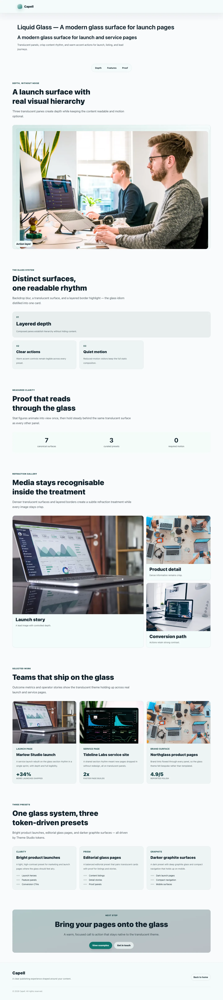
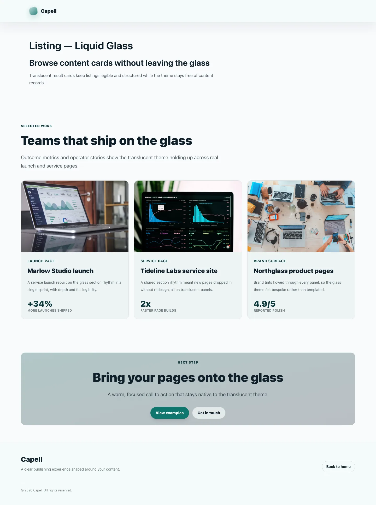

# Theme Liquid Glass

<!-- prettier-ignore-start -->

Cards, figures and a floating row of shortcut links sit on frosted, see-through panels, and the page behind them shows through as a soft blur. You pick one of three looks. Clarity is teal and orange on a pale mint page. Prism is cyan and pink on pale blue, with larger headings and more room around things. Graphite is slate and amber on near-black.

Six of the theme's eight extra blocks, the ready-made sections you place on a page, use those panels. They include a call to action and a showcase of cards with images. A strip of figures counts up once.

Editors fill in each block's wording in an editing form in the widget editor. Until the wording is filled in, four of them show built-in sample headings. The footer shows the site name and a copyright line built from the site title and the year. Sections shared from Foundation do not get the blur. The theme needs the Foundation theme and Layout Builder, the page builder, installed.

On a device set to dark, the header and the panels in the eight blocks turn dark in all three looks. Before you apply the theme to the live site, you can preview it privately on your own pages.

- **Price and availability:** Check current availability and price on the [Capell Marketplace listing](https://capell.app/extensions/theme-liquid-glass).
- **Licence:** Published under MIT in `composer.json`.
- **Requires:** `PHP ^8.4`, `capell-app/core ^1.0.72`, `capell-app/theme-foundation ^1.0`, `capell-app/frontend ^1.0`, `capell-app/layout-builder ^1.0`.
- **Install:** `composer require capell-app/theme-liquid-glass`.

## Quick Start

1. Install the package: `composer require capell-app/theme-liquid-glass`.
2. See it working on a disposable site: run `php artisan capell:theme-liquid-glass-demo --sites="Theme demo"`. Choose a new site name for your demo; keep customer sites for the Preview → Apply workflow above.
3. Run `php artisan list` and verify the package command signatures are registered.

## For Developers

Typed widget keys and a layout-native provider connect bespoke presentation to the shared Layout Builder container pipeline.

## Configure

- **Commands:** `php artisan capell:theme-liquid-glass-demo`.

## Limits And Pitfalls

- Install the required Capell packages at the versions in `composer.json`: `capell-app/core ^1.0.72`, `capell-app/theme-foundation ^1.0`, `capell-app/frontend ^1.0`, `capell-app/layout-builder ^1.0`.
- Keep public Blade and cached HTML free of authoring markers, model IDs, permissions, signed editor URLs, and lazy database queries.
- Custom write integrations must preserve invalidation for `theme-liquid-glass` cache tags.

## Screens And Workflow

- Liquid Glass Homepage (frontend).
- Liquid Glass Directory (frontend).
- Liquid Glass Detail Article (frontend).
- Liquid Glass Contact (frontend).
- Liquid Glass Empty State (frontend).
- Liquid Glass Page Not Found (frontend).
- Liquid Glass Call To Action (frontend).

## Install Impact

- Required packages: `capell-app/core`, `capell-app/theme-foundation`, `capell-app/frontend`, `capell-app/layout-builder`.
- Admin navigation: declares `admin-page: ThemeManagementPageContribution`; each Filament page or resource controls its own navigation visibility.
- Admin/editor extensions: none declared.
- Permissions: no package permission declarations or Shield gates detected; host access rules still apply.
- Public routes: none declared.
- Database changes: no package migrations declared.
- Config: no package config files.
- Settings: no package settings declared.
- Queues or schedules: none declared.
- Cache tags: `theme-liquid-glass`.
- Commands: `capell:theme-liquid-glass-demo`.

## Troubleshooting

| Symptom | Likely cause | Check | Fix |
| --- | --- | --- | --- |
| Package surface is missing after install | Provider or manifest is not loaded | Confirm `capell.json`, package `composer.json`, and provider registration | Reinstall the package, refresh Composer autoload, and clear host caches |
| Public output leaks unexpected state | Render data, cache variation, or authoring boundary has regressed | Check public Blade, cache tags, and public-output safety tests | Move data loading out of Blade and rerun the package public-output tests |

## Upgrading

No manual steps between minor versions.

Read [CHANGELOG.md](CHANGELOG.md) before upgrading.

## Next Steps

- [Package docs](docs/README.md)
- [Overview](docs/overview.md)
- [Troubleshooting](#troubleshooting)
- [Developer reference](docs/reference.md)
- [Marketplace assets](docs/assets/marketplace/)
- [Capell content language plan](../../docs/CONTENT_LANGUAGE_PLAN.md)
- [Capell documentation design system](../../docs/DESIGN_SYSTEM.md)
- [Capell and package ERD notes](../../docs/erd/capell-and-package-erds.md)
- Related packages: [Foundation Theme](../theme-foundation/README.md), [Layout Builder](../layout-builder/README.md).

<!-- prettier-ignore-end -->
